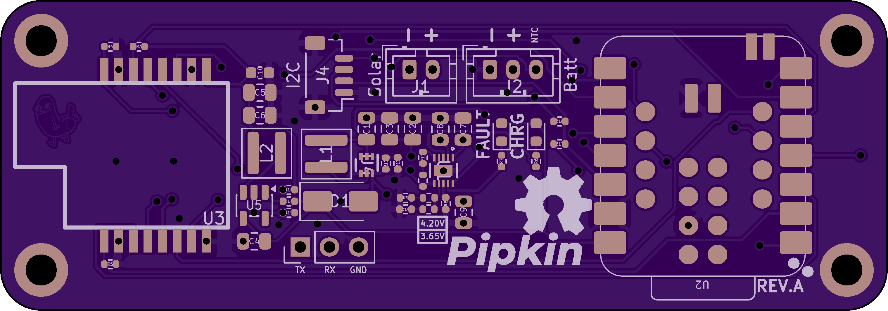

# Pipkin
A 2.4GHz LoRa radio based on the XIAO nRF54L15 (or optionally nRF54840) and the EBYTE E28-2G4M27SX.

## Hardware diagnostic firmware

See [`test_firmware`](test_firmware) for the PlatformIO project used to test
SX1281 SPI communication and scan the external I2C connector.
