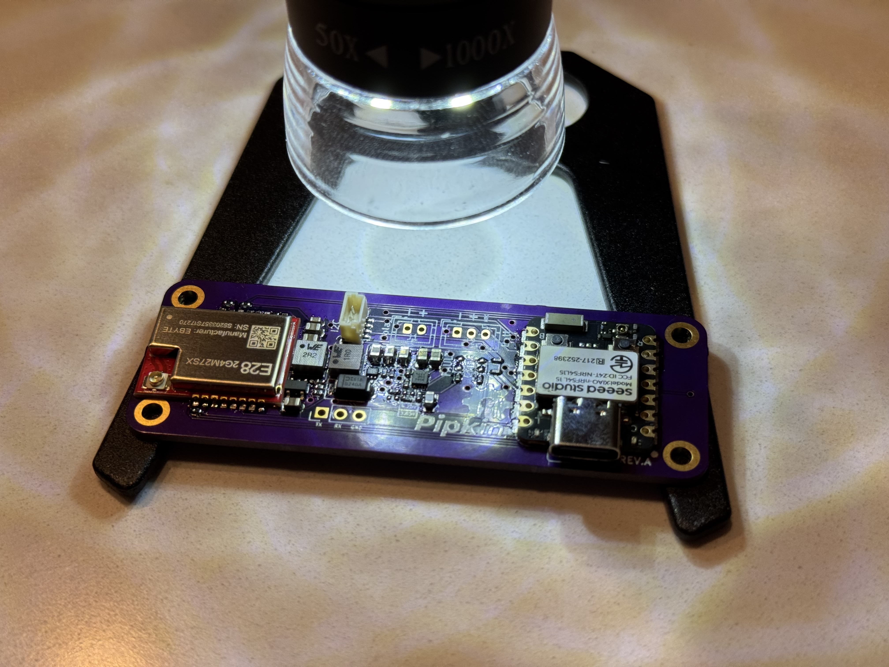

# Pipkin
A 2.4GHz LoRa radio based on the XIAO nRF54L15 and the EBYTE E28-2G4M27SX. REV.A is fully validated and known to work on a hardware level.

More images can be found in [/assets/](https://github.com/Sidpatchy/pipkin/tree/main/assets)

## Hardware diagnostic firmware
See [`test_firmware`](test_firmware) for the PlatformIO project used to test
SX1281 SPI communication and scan the external I2C connector.

## XIAO nRF52840
While untested, the radio will still theoretically work with a XIAO nRF52840. I2C and DI02/DI03 are lost with the nRF52 board as it lacks extra GPIO underneath. The battery + and - terminals on the XIAO or Pipkin board should be masked to prevent shorts if an nRF52840 board is used.
